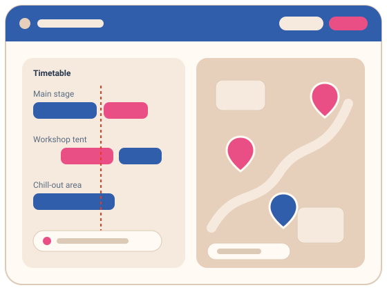

  

<h1 align="center">Burnigator</h1>

  <strong>Your event, its map and its programme in one web app.</strong> 
  Interactive image map, 24-hour programme and community pinboard. Runs on standard PHP hosting.

  <a href="https://burnigator.com">Website</a> ·
  <a href="#features">Features</a> ·
  <a href="#installation">Installation</a> ·
  <a href="CONTRIBUTING.md">Contributing</a> ·
  <a href="LICENSE">AGPL-3.0</a>

  

Burnigator is an event management tool for standard PHP web hosting, with isolated application copies for hosted events and a self-hosted deployment path. It brings together an image map, a 24-hour programme, event information, and an optional pinboard. Owners manage event details, locations, schedules, accounts, appearance, publication, and integrations from the admin panel.

The application uses [Leaflet](https://leafletjs.com/) with `CRS.Simple`; the map is an image, not a geographic map. It is designed for shared PHP hosting such as ALL-INKL and does not need Docker, Composer, or a build step. The core map works without a database; the optional event authentication and pinboard features use MariaDB.

Learn more, and see what Burnigator offers guests and organizers, at **[burnigator.com](https://burnigator.com)**.

## Features

- **Interactive image map:** The visitor view opens on the timetable by default. Visitors can switch to the image map, which fits the full image into view the first time it is opened, then pan and zoom. POIs have Font Awesome icons and categories. Visitors can search places, show or hide POI names, and hide categories; owners can choose monochrome or colored POI icons.
- **Festival timetable:** Browse Wednesday through Sunday one day at a time. Each day spans 24 hours, places appear as rows, and event blocks are positioned at their start and end times. The current-time indicator, favourite filter, and event-category filters help visitors find programme items.
- **Independent timelines:** Add up to three named programme rows that are not attached to a place.
- **Event details and favourites:** Events can include a host, description, multiple categories, and an external link with a custom label. Visitors open the details card by selecting an event and can save favourites in their browser; favourites remain after a reload on that device.
- **Print exports:** Export the map with a numbered place index or export the selected timetable day as a high-resolution JPEG. The exports target A2 printing and 300 DPI where browser canvas limits permit. A configured QR URL is included in the exports.
- **Admin panel:** Manage POIs, categories, events, independent timelines, general configuration, accounts, backups, and change history. Configuration is split into four categories, with event authentication grouped under User management. Owners can fully reset an installation from Security & History after confirming the action. Places are grouped by category and can be collapsed for a more compact overview.
- **Hosted pilot visibility:** New installations start unpublished. Signed-in festival editors can preview the map and timetable; only the owner can publish or unpublish the visitor view. A **preview mode** switch lets you publish early with just the map: while the "Show timetable and pinboard to visitors" switch is off, visitors see only the map, without timetable, favourites and pinboard, while signed-in team members still see everything. This hides the views in the page; the programme data is still part of the public data.
- **Optional integrations:** Configure a SoundCloud playlist (the player stays hidden until you enter a public playlist URL), a Matomo tracking URL and site ID (tracking is off until you set them), and the browser's experimental translation API for event descriptions. The optional pinboard requires a paid Pretix order to post, gives each order a burner pseudonym, and can be switched on in setup or Configuration → Event & Pinboard. Pretix API sync and a two-column CSV fallback are available. The compact SoundCloud player offers play/pause, random next track, 30-second skip, volume control, and a link to the current track.
- **Branding and navigation:** Upload a title logo and favicon, set a custom top-bar button, link the event title to a website of your choice, and configure an optional legal notice link. The favicon is also used to generate the installed web app icon.
- **Responsive German and English interface:** The visitor and admin views adapt to mobile screens. Users can switch the UI language; the selection is kept in the browser.
- **Installable and offline visitor view:** A service worker caches the visitor shell, map data, and current image assets. On app start, the app requests fresh data when online and falls back to its cached copy while offline.

## Requirements

- PHP 7.4 or newer with JSON, sessions, file uploads, and filesystem locking
- MariaDB/MySQL and PDO MySQL for event authentication and pinboard; OpenSSL and cURL are needed for Pretix API token storage and synchronization
- An Apache-compatible web server with `.htaccess` support
- HTTPS for normal use and service-worker/PWA support (localhost is suitable for local development)
- One complete application copy and writable data/upload directories per hosted festival instance
- Writable `data/` and `uploads/` directories; during first-time setup PHP must also be able to create `config.php` (make the application directory writable, or copy `config.sample.php` to `config.php` and make that file writable)
- GD is recommended for generating resized app icons from the uploaded favicon. If it is unavailable, the built-in app icons are used.

Leaflet, Font Awesome, and the QR code library are bundled locally. SoundCloud and Matomo require an internet connection. Browser translation is experimental and only appears in browsers that support the relevant APIs.

## Installation

1. Download or clone this repository.
2. Upload the **contents of the repository root** to a web directory, for example `www/burnigator/`. Do not upload a parent archive folder as an extra nested directory.
3. Make sure PHP can write `config.php` (create it by copying `config.sample.php`, or make the directory writable), `data/`, and `uploads/` for the initial setup. The setup creates `data/map.json` and installs the owner account.
4. Open `https://your-domain.example/burnigator/setup.php` and follow the wizard. Set a strong owner password of at least 12 characters. Setup chooses a random harmonious color palette and collects optional settings. You can optionally enter MariaDB credentials (the wizard tests the connection) and enable the pinboard. The database can also be configured later; the map itself does not require it. Setup generates the event-auth secret and stores it in the server-side `config.php`.
5. Sign in at `https://your-domain.example/burnigator/admin.php` with username `owner` and the password you chose.
6. Upload your event map (PNG/JPG), create categories, and add places. Set each POI's name, icon, description, category, and position. Enable **Has programme** to add events.
7. Use the Configuration categories to set appearance, integrations, event authentication and pinboard options, accounts, and the legal notice link.
8. The festival stays private after setup. Sign in as the owner, check the visitor preview, then publish it from Configuration when it is ready.

For hosted festivals, provision a separate application directory and data/upload folders for each festival, then run the setup wizard separately in each copy. Setup assigns each copy a random installation ID. Do not clone an already-installed festival's `config.php`, `data/`, or `uploads/` into a second tenant. Keep each festival on its own subdomain; its session cookie and service-worker cache are also namespaced to its installation.

After setup, `config.php` does not need to remain writable. `config.php` is created by setup and is ignored by git, so it never ends up in the repository. Keep `data/` and `uploads/` writable by PHP because the application stores changes there.

## Updating an existing installation

Upload updated application files over the existing installation, but **preserve the server's `config.php`, `data/`, and `uploads/`**. These contain the installed owner credential hash, map and programme data, additional accounts, snapshots, change history, and uploaded images. In particular, never replace the live `config.php`; the repository only ships the template `config.sample.php`.

**Tracking and the SoundCloud player are off by default.** Older versions fell back to a built-in Matomo address and SoundCloud playlist when none was saved. If your installation relied on those fallbacks, enter your Matomo URL, site ID and playlist URL again under Configuration → General.

Keep the `.htaccess` files in the application root, `data/`, and `uploads/`. If you have made local customizations to application files, merge those before replacing them.

## Admin accounts and permissions

The owner account has full access, including general configuration, categories, the event map, backups, snapshots, and account management. The owner can change their password in the Security & History tab.

The owner can create two optional limited accounts:

| Account | Permissions |
| --- | --- |
| POI editor | Add, move, edit, and delete POIs, including assigning them to existing categories. It cannot create or edit categories, change the event map, or edit programme data. It cannot delete a POI that has programme events attached. |
| WWW account (legacy) | Read-only access. Event programme and timeline changes are Owner-only. |

Each limited account has its own username and password. Passwords must be at least 12 characters. Leaving a password blank while saving keeps an existing password; clearing the username and saving removes that account.

## Configuration

The owner-only Configuration area is split into four categories: General (publication and preview mode, general settings, appearance, SoundCloud, and Matomo), Event (categories and pinboard), User management (additional accounts, event authentication, and owner password), and Security & History (change history, backups, automatic snapshots, and application reset).

- General title, custom top-bar button, optional title link URL, optional legal notice URL, optional WWW-export QR URL, and browser translation toggle
- SoundCloud player visibility and public playlist URL
- Main UI colors, title logo, and favicon
- Matomo base URL and site ID; an empty Matomo URL disables tracking
- Limited account management and owner password change
- Pretix authentication settings, manual synchronization, CSV fallback import, and a stored-order overview grouped by Pretix status, import source, posting eligibility, and count. Order numbers are not exposed in the admin page.
- Pinboard activation and post moderation
- Change history, data import/export, and snapshot restore
- Full installation reset, including event data, uploads, accounts, and event-authentication records. The reset requires the current Owner password and an exact confirmation phrase, then returns the application to first-time setup.

Setup randomly chooses from five coordinated palettes. The original blue, pink, orange-red, and warm-cream colors (`#305EAA`, `#E94F85`, `#E63D1A`, `#E6D0BB`) remain the fallback for installations without a saved theme. The pinboard starts disabled and requires a MariaDB database to save posts. The SoundCloud player and Matomo tracking are off until you configure them.

## Data model and storage

The map, programme, and images remain in JSON files and the filesystem. Event authentication and the pinboard use MariaDB/MySQL through PDO. Public visitor data is served by `api.php`. All write actions require an authenticated session, an appropriate role, and CSRF protection.

See [docs/event-auth-v1.md](docs/event-auth-v1.md) for database setup, Pretix synchronization, CSV import, event-scoped identity, and pinboard permissions.

At a high level, the map data contains:

- **Categories:** names and colors
- **POIs:** a stable ID, normalized `x`/`y` coordinates, name, description, category, icon, and optional programme
- **Events:** start/end time, title, host, description, selected event categories, and optional external link and link text
- **Independent timelines:** up to three named rows with the same event structure
- **Configuration:** theme, branding paths, optional links, tracking, translation, SoundCloud settings, publication state, preview mode, and pinboard activation

POI coordinates are normalized from `0` to `1`, so marker positions scale with the uploaded image. Programme days use the keys Wednesday through Sunday; event times use 24-hour `HH:MM` format. An event end time, when set, must be later than its start time on the same day.

Runtime files are stored as follows:

| Path | Contents |
| --- | --- |
| `config.php` | Created by setup (template: `config.sample.php`). Installation ID, owner password hash, generated event-auth secret, and optional database credentials |
| `data/map.json` | Map, categories, POIs, programmes, timelines, and configuration |
| `data/accounts.json` | Active owner and optional limited-account password hashes after account changes |
| `data/history.json` | Recent admin changes by username and role |
| `data/login-attempts.json` | Login throttling state |
| `data/snapshots/` | Up to five recent map-data snapshots |
| `uploads/` | Event map, title logo, and favicon |

Do not commit live runtime data, password hashes, or uploaded event/map images to a public repository. Back up `config.php`, `data/`, and `uploads/` separately from the application source.

## Security and hosting notes

- The root `.htaccess` prevents directory listings and blocks direct access to `config.php`.
- `data/.htaccess` blocks all direct web access to JSON data and snapshots.
- `uploads/.htaccess` blocks PHP and other script execution while allowing the browser to load uploaded images for the public map.
- Passwords are stored as password hashes. Login attempts are throttled after five failed attempts from the same IP address for 15 minutes.
- HTML pages send a Content-Security-Policy that allows only the site itself, the SoundCloud player, and the configured Matomo host, together with `X-Content-Type-Options`, `X-Frame-Options`, `Referrer-Policy` and `Permissions-Policy` headers. The `.htaccess` adds the same headers for static files when `mod_headers` is available.
- Sessions use installation-specific, host-only cookies with `HttpOnly` and `SameSite=Lax`; cookies are marked `Secure` when HTTPS is active. Service-worker cache names also include the installation ID, and cleanup is limited to that installation's caches.
- Unpublished map data is served only to signed-in festival accounts and is excluded from offline data caching. If a visitor saved a previously published version for offline use, taking the site offline cannot immediately erase that device's already downloaded copy.
- Image uploads are validated by format and size. The event map may be up to 20 MB; branding PNGs may be up to 5 MB.
- The application uses file locks and revision checks to prevent concurrent saves from silently overwriting newer map data.
- Older installations without a saved publication setting remain public after upgrade; only new setup runs default to unpublished.

If the host ignores `.htaccess`, do not expose the `data/` directory publicly. Ask the hosting provider how to deny direct access or move private storage outside the web root and adjust the application paths accordingly. The `uploads/` directory must serve the referenced image files to visitors, while script execution there must remain disabled.

## Backups and recovery

The Configuration area provides a full JSON backup and restore workflow. A full backup contains the map, categories, POIs, programmes, timelines, map configuration, and uploaded image assets. It does not include the MariaDB database, so back up that database separately when event authentication or the pinboard is enabled. Before data changes, the application also creates snapshots and retains the latest five; the owner can restore these in the admin panel. A full application reset deletes the current installation data rather than creating a recoverable snapshot, so download a backup first.

Keep an independent FTP or hosting backup of `config.php`, `data/`, and `uploads/`, plus the MariaDB database when configured. A full backup downloaded from the admin panel is convenient for migration, but it should also be stored somewhere safe outside the web server.

## Privacy and analytics

Matomo tracking is off by default. It only runs when the owner enters a Matomo URL and site ID, and clearing the URL disables it again. When enabled, the app sends page views and interaction events such as map POI clicks, timetable event interactions, favourites, and media-player actions to the configured Matomo installation. SoundCloud playback is served by SoundCloud. Browser-stored favourites and map/category display preferences remain local to the visitor's device.

## Links

- **Website:** [burnigator.com](https://burnigator.com)
- **Source and issues:** [github.com/galonga/burnigator](https://github.com/galonga/burnigator)
- **Contributing:** [CONTRIBUTING.md](CONTRIBUTING.md)
- **Security reports:** [SECURITY.md](SECURITY.md)

## Project structure

| Path | Purpose |
| --- | --- |
| `index.php` | Public map and timetable |
| `admin.php` | Login and admin interface |
| `setup.php` | First-install configuration wizard |
| `api.php` | Public read endpoint and authenticated write actions |
| `auth.php` | Account, role, login, and security header support |
| `config.sample.php` | Template for `config.php`, which setup creates |
| `theme_bootstrap.php` | Passes the saved theme colors to the page before first paint |
| `assets/map.js` | Map, timetable, player, exports, and visitor interactions |
| `assets/admin.js` | Admin editing and configuration |
| `assets/style.css` | Application styles |
| `assets/design-system.css` | Shared UI tokens, components, and states |
| `assets/i18n.js` | German and English UI strings |
| `sw.php` | Serves the installation-specific service worker |
| `sw.js` | Service-worker source template |
| `docs/agents/` | Issue tracker, triage-label, and domain-doc guidance for engineering skills |
| `DESIGN_SYSTEM.md` | Design-system guidance for interface changes |
| `VERSION` | Current version (CalVer `YEAR.MONTH.BUILD`); single source for the footer, asset cache-busting and the service-worker cache |
| `CHANGELOG.md`, `UPGRADING.md`, `RELEASING.md` | Release notes, upgrade guide and the maintainers' release process |
| `docs/images/` | Logo and illustration used in this README (also used on burnigator.com) |
| `CONTRIBUTING.md`, `SECURITY.md` | How to contribute and how to report vulnerabilities |
| `THIRD_PARTY_NOTICES.md` | Licenses of bundled libraries |

## Development notes

- There is no compilation step or dependency installation. The local Leaflet, Font Awesome, and QR code assets are committed with the application.
- See [`CONTRIBUTING.md`](CONTRIBUTING.md) for the full workflow. JS and CSS are formatted with Prettier (`.prettierrc.json`).
- Follow [`DESIGN_SYSTEM.md`](DESIGN_SYSTEM.md) and `assets/design-system.css` when changing UI. Use the semantic color, typography, spacing, shape, and control-size tokens, and keep applicable interaction states consistent across visitor and admin screens.
- Versions use CalVer (`YEAR.MONTH.BUILD`, for example `2026.11.1359`) from the `VERSION` file. When changing application code or the visitor shell, increase the build number (the last number) in `VERSION`; the footer, asset cache-busting and the service-worker cache derive from it, so installed/offline clients receive the new version. See [`RELEASING.md`](RELEASING.md).
- GitHub Issues for this project live at [galonga/burnigator](https://github.com/galonga/burnigator). Repository-specific issue, triage, and domain-doc conventions are in `docs/agents/`.

## License

Burnigator is free software, released under the [GNU Affero General Public License v3.0](LICENSE) (AGPL-3.0). You may use, study, modify and share it. If you run a modified version as a network service, the AGPL requires you to offer the source code of your modified version to its users. The visitor page footer links to [burnigator.com](https://burnigator.com), which points to the source, as the AGPL requires for network use. The bundled third-party libraries keep their own licenses; see [THIRD_PARTY_NOTICES.md](THIRD_PARTY_NOTICES.md).
